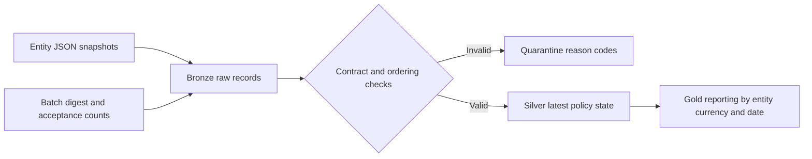

# Insurance reporting data platform

A runnable reference implementation for controlled ingestion of insurance reserve snapshots. Built as an independent portfolio exercise, using synthetic records; it does not calculate actuarial reserves or reproduce an employer's systems.

## Run

Python 3.10+; standard library only. From this directory:

```sh
export TOKEN_KEY='local-demo-key-at-least-32-characters'
python3 pipeline.py sample.json --batch october --db /tmp/insurance-demo.db
python3 -m unittest discover -s tests -v
```

Expected first-run result: 3 accepted, 1 rejected; IE EUR reserves 200075 cents and UK GBP reserves 45000 cents. Repeating the identical batch has no additional effect. The supplied key is for demonstration only.

## Architecture



The transaction commits bronze, quarantine, silver and batch metadata together. A single writer lock serialises competing runs. A SHA256 digest binds a batch identifier to exact source bytes. Changed content under an existing identifier fails; a byte-identical replay returns the original result. Formatting changes also change the digest, deliberately.

The grain is one latest accepted snapshot per globally unique policy identifier. Entity-specific identifiers must be namespaced before ingestion. Gold groups by valuation date: it is not a historical valuation store or a consistent period close across entities. A production close would enforce a period completeness manifest and maintain versioned snapshots. Reserves use integer minor units, avoiding binary floating point; the supported currencies all use two decimal places. Currency totals are never combined without an explicit FX policy.

## Controls and limitations

- Strict field contract, ISO dates, supported currencies, finite nonnegative two-decimal reserves, duplicate detection and monotonic snapshot dates.
- Accepted plus rejected equals input row count; the tests check this alongside exact reporting totals.
- Deterministic HMAC SHA256 tokens remove customer identifiers from silver. This is pseudonymisation, not anonymisation. Raw bronze still contains identifiers.
- No API, authentication, encryption-at-rest, RBAC or retention enforcement is implemented. Do not use real customer data. SQLite file permissions are not enterprise security.
- Invalid JSON aborts before data mutation. Database failures roll back the complete batch. Business-invalid rows are quarantined while valid rows continue; period publication should require explicit control approval.
- HMAC rotation requires reprocessing from an authorised source and a token-version migration. Keep real keys in a secrets manager, not source control.

## Azure target design and decisions

This is a proposed deployment design, not a tested Azure deployment or a claim of commercial Databricks experience.

| Concern | Proposed implementation | Tradeoff |
| --- | --- | --- |
| Storage | ADLS Gen2 bronze restricted to ingestion and data stewards | Raw retention supports audit but increases privacy exposure |
| Processing | Azure Databricks jobs and Delta bronze/silver/gold tables | Distributed processing adds cost and operational complexity |
| Governance | Unity Catalog permissions, lineage and service principals | Separate storage permissions must also be constrained |
| Secrets | Key Vault backed secret management | Rotation and audit ownership must be defined |
| Serving | Approved period-close gold tables for BI | Publication waits for completeness and reconciliation |
| Recovery | Source manifests, Delta versions, replay ledger | Multi-table writes need a publication protocol; SQLite atomicity does not transfer automatically |

ADRs: (1) use SQLite locally to make controls inspectable without cloud spend; (2) keep raw evidence separate from curated state; (3) reject equal-date corrections until a revision field and approval workflow exist; (4) quarantine record failures but block publication on incomplete submissions. Cloudera CDP could host analogous stages with object storage and Spark, but no CDP implementation is supplied.

## Operating model

Data owners approve contracts and close completeness. Engineers operate ingestion and recovery. Data stewards resolve quarantined records. Finance signs off reporting reconciliation. Security owns key access and retention policies. These are proposed responsibilities, not evidence of a team led by the author.

Before production: define volume and latency targets with stakeholders; load-test representative data; implement immutable versioned submissions, migrations, deletion policy and access tests; add orchestration, alerts and cloud recovery drills. An illustrative close target is all contracted entities received and reconciled before publication, with no unresolved critical quality failures. No throughput or cost benchmark is claimed.

## Interview walkthrough

1. Run the sample and explain why the negative reserve is rejected (and when the business contract might need signed amounts).
2. Replay it and explain the batch digest and exactly-once effects within this database.
3. Walk through the rollback test and distinguish transactional guarantees from distributed cloud delivery.
4. Explain the latest-state model, missing history and period-close completeness problem.
5. Discuss why HMAC is preferable to plain hashing for low-entropy identifiers and why bronze remains sensitive.
6. Describe how you would validate the proposed Azure implementation before claiming it works.

Authorship transparency: this portfolio implementation was created with AI assistance. Review, modify and reproduce the tests before representing personal mastery of it.
